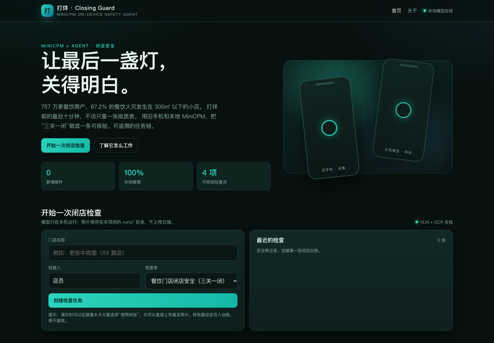
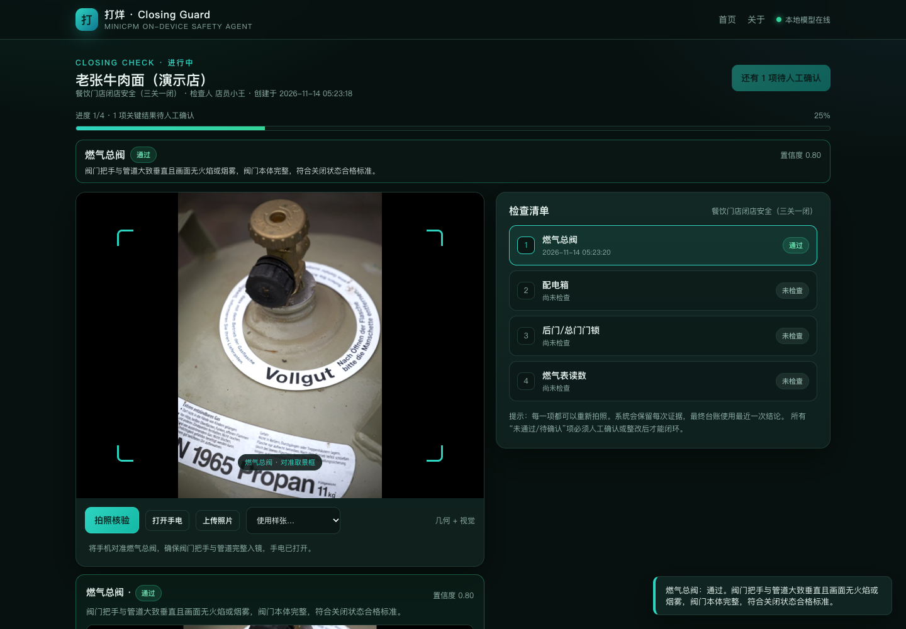
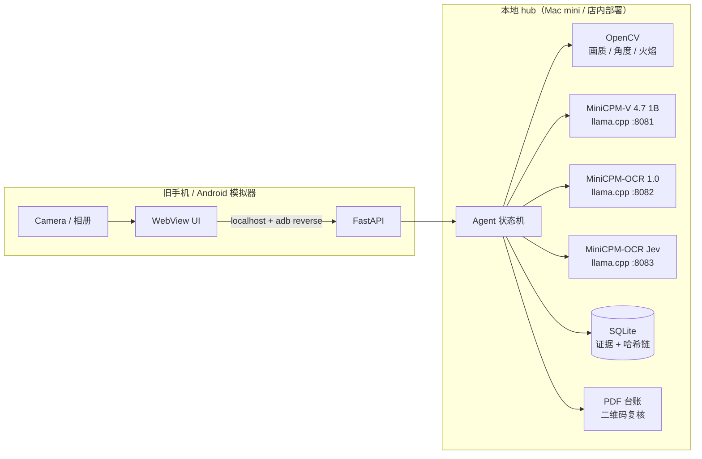

# 打烊 · Closing Guard

> **一个会拒绝签字的闭店安全 Agent。**  
> 用闲置安卓手机 + 本地 MiniCPM，把“三关一闭”做成一条可核验、可追溯的任务链。

[](https://github.com/HankGuo/closing-guard/actions/workflows/ci.yml)
[](LICENSE)
[](server/)
[](android/)
[](https://github.com/OpenBMB/MiniCPM-V)
[](https://github.com/OpenBMB/MiniCPM-OCR)
[](https://huggingface.co/openbmb/MiniCPM-OCR-Jev)

[▶ 观看 58 秒演示](https://github.com/HankGuo/closing-guard/releases/download/v0.1.3/demo_v2.mp4)



---

## 为什么做这个

我不缺“AI 能看图”的 demo，缺的是“看完敢签字”的东西。

起因是一次在街边小店吃饭，走的时候看见店员在群里发一张照片，配文“已闭店”。照片拍的是灶台，阀门在画面边缘，看不清是开是关。那一刻我意识到：**闭店这件事的验收，一直是靠一张没有人核验的照片。**

技术上的转折点在端侧：1B 级多模态模型第一次能在旧手机级别的算力上“看懂”阀门、门锁、配电箱，还能按 JSON 输出判断和理由。成本几乎为零——店里本来就有不用的旧手机。

我做这个项目，不是想让 AI 替店员签字，而是想让“关没关”第一次留下能被复核的证据：谁在什么时候检查了什么、模型给出什么判断、人确认了什么、这份台账有没有被改过。

意义有三层：

- 对店主：万一出事，拿得出当时确实关了的记录
- 对店员：不是被监控，是被提醒“这项你还没拍”
- 对监管与物业：有一份可抽检的台账，而不是一摞纸质表

这也决定了它的形态：**必须本地、必须留证据、必须允许人说“不”。**

## 适合谁 / 不适合谁

**适合**：街边小餐饮、连锁门店店长、商场物业巡检、社区安全网格员。

**不适合**：大型工厂（已有工业级安全系统）、需要法律效力认定的保险理赔（需要第三方公证）。

---

## 它解决什么问题

中国有 **757.77 万家**餐饮商户。近三年餐饮场所火灾 **4.21 万起**，其中 **87.2%** 发生在 300㎡ 以下的小店；电气故障、用火不慎、燃气泄漏是主要起火原因。

> 以上三组数字来自公开报道与行业通报口径，作者未逐条独立核实；引用时请以应急管理部门发布的原始通报为准。

商场里的“三关一闭”（关水、关电、关燃气、闭门）有物业逐店检查，标准写得很细：阀门与管道呈 90°、水龙头无水流、燃气报警器常开、厨房自灭系统在工作。街边小店呢？**没人查，靠店员自觉，纸质表/问卷星拍张照，照片里阀门到底关没关，没人知道。**

这个项目把闭店检查变成一条 **Agent 任务链**：

1. 旧手机/模拟器打开取景框，语音/屏幕引导店员逐项拍摄；
2. 本地 **MiniCPM-V 4.7 1B** 判断语义状态，**MiniCPM-OCR 1.0** 读取表计，**MiniCPM-OCR Jev** 给读数做一致性门控，**OpenCV** 做几何/火焰交叉检查；
3. 模型不确定 → 要求重拍；异常 → 要求整改；关键项 AI 通过也**必须人工确认**；
4. 最后生成一份带 **SHA-256 哈希链** 的闭店安全台账（PDF/JSON），扫码可复核。

> **它不是“又一个摄像头”。** 它不满足于“拍照留痕”，它会 **拒绝让你点完成**。



---

## 它不是什么

- **不是通用旧手机助手**：OpenClaw 等已经做了通用 Agent；这里只做“闭店三关一闭”这一件有物理后果的任务。
- **不是家庭摄像头日报**：已有的「家庭视觉助手」已经做过“摄像头写日报”；这里做的是**主动引导 + 逐项核验 + 异常复查 + 签字台账**。
- **不是云监控**：没有云 API、没有视频上传；模型和证据都在本机。
- **不是“全自动安全保证”**：模型会错，关键项必须人工确认；这是设计，不是补丁。

---

## 架构



| 组件 | 技术 | 作用 |
|---|---|---|
| 设备端 | Android WebView（`minSdk 24`） | 相机、屏幕、喇叭、触摸；加载本地 Web UI |
| Web UI | React + TypeScript + Vite | 移动优先的检查流程、证据预览、确认签字 |
| Hub | Python 3.11 + FastAPI + SQLite | 会话、状态机、证据、报告 |
| 视觉 | OpenCV | 画质门控、阀门主方向、火焰颜色交叉检查 |
| 语义 | MiniCPM-V 4.7 1B（GGUF Q4_K_M） | 判断阀门/门锁/电箱的语义状态 |
| 读数 | MiniCPM-OCR 1.0（GGUF Q8_0） | 读取表计/温度计/压力表 |
| 读数核验 | MiniCPM-OCR Jev（GGUF Q4_K_M） | 给 OCR 候选打一致性分：高→自动接受；低→人工 |
| 证据 | SHA-256 链 + WeasyPrint | 防篡改台账、二维码复核 |

### 判定融合（关键设计）

```text
画质不合格            -> unsure（先重拍，不调用模型）
火焰色交叉检查命中    -> fail（即使 1B 说 pass）
几何角度差 > 容差      -> fail（仅当 CV 置信度足够）
1B 明确 fail          -> fail
1B pass + 置信度足够  -> pass（关键项仍需人工确认）
其他                  -> unsure（重拍/人工确认）
```

**为什么不让 1B 单独决定？** 在测试中，1B 对“配电箱开关朝上/朝下”的判断并不可靠：它曾在一次运行中把 ON 的配电箱判成 pass。系统因此规定：燃气阀、配电箱、门锁三个关键项，即使 AI 判 pass，也必须人工确认才能闭环。台账记录“AI 建议 + 人工签字”，而不是伪装成“AI 保证”。

---

## 这里说的“端侧”是什么

**端侧 = 店内本地，不上云**：模型跑在店里的一台本地 hub（现在的实现是笔记本/迷你主机；手机内推理在路线图上），照片、判定、台账全部留在本机，没有云 API、没有视频上传。

之所以不用“手机内推理”作为当前卖点：1B 多模态在 Android 上跑 llama.cpp 还需要额外适配，现在没做，所以如实写成路线图。

## 环境边界

**能跑**：macOS 13+（Apple Silicon 完整跑通，实测）、Ubuntu 22.04+（依赖与单测实测通过）、WSL2。

**不能跑**：原生 Windows（脚本是 bash，不打算适配）、Intel Mac（未验证）、内存小于 8GB 的机器、无 AVX 的老 CPU。

**未验证**：Linux 上的完整模型端到端（Linux 只验证了依赖安装和单元测试）。

**硬条件**：Python 3.11、Node 20、`llama-server` 在 PATH、5.5GB 模型下载、8GB 内存、8GB 磁盘。

**不打算做的适配**：原生 Windows 一键脚本。想跑请用 WSL2；不想装环境，看视频、截图和评测报告同样能判断项目真假。

---

## 快速开始

### 一条命令跑起来

```bash
git clone https://github.com/HankGuo/closing-guard.git
cd closing-guard
make demo          # 检查环境 → 装依赖 → 下模型 → 起服务 → 打印访问地址
```

`make demo` 等价于 `bash scripts/quickstart.sh`，会自动执行下面 1–3 步并等待 API 就绪，最后输出 `http://localhost:8010`。
只检查环境不下载模型：`bash scripts/quickstart.sh --check`。

### 0. 环境

**已验证**：macOS 13+（Apple Silicon 实测）、Ubuntu 22.04+（单元测试实测）、GitHub Actions。
**未支持**：原生 Windows（请用 WSL2）、Intel Mac、<8GB 内存机器。

- Python 3.11+、Node 20+、bash
- 本地推理：`llama.cpp`，要求 `llama-server` 在 PATH（macOS `brew install llama.cpp`）
- 内存 ≥ 8GB（1B 模型峰值约 5.1GB）、磁盘 ≥ 8GB
- 模型：约 5.5GB，首次由 `make models` 自动下载
- 不想装环境？直接看 [56 秒演示](https://github.com/HankGuo/closing-guard/releases/download/v0.1.2/demo_v2.mp4) 和 `docs/screenshots/`
- 只想验代码真伪？跑单测，不需要模型：见运行手册「路径 B」

### 1. 安装

```bash
git clone https://github.com/HankGuo/closing-guard.git
cd closing-guard
make setup
```

### 2. 下载模型并启动本地模型服务

```bash
make models     # 从 ModelScope 下载 1B/OCR GGUF 到 ~/.cache/closing-guard/models
make serve      # 启动 VLM :8081 + OCR :8082
```

> 模型权重不提交到 git。`scripts/download_models.sh` 是唯一的可复现下载入口。

### 3. 启动 API + Web

```bash
make web        # 构建前端到 web/dist
make api        # http://localhost:8010
```

打开 <http://localhost:8010>。首次使用建议先选“使用样张”跑一遍，再上传真实照片。

### 4. Android（可选，真机/模拟器）

```bash
make android
adb install -r android/app/build/outputs/apk/debug/app-debug.apk
adb reverse tcp:8000 tcp:8010   # 让设备上的 localhost:8000 指向本机 8010
adb shell am start -n com.closingguard.app/.MainActivity
```

App 是一个极薄的 WebView 壳：相机、屏幕、触摸来自手机，模型和证据都在本地 hub。这样旧手机（Android 7+）也能用，不需要在手机上编译 llama.cpp。

---

## 真实测试（没有 mock）

### 测试矩阵

| 层级 | 命令 | 结果 |
|---|---|---|
| 单元测试（CV / 链哈希） | `make test` | **8 passed** |
| HTTP 端到端（真实模型） | `make e2e` | **1 passed in 14.38s** |
| Android WebView 端到端 | `python scripts/android_e2e.py` | **ANDROID_E2E_OK**，哈希链 `valid=true` |
| Android WebView 渲染 | `docs/screenshots/` | 已用真机/模拟器验证页面能加载并完成核验流程；模拟器相机为虚拟场景，不作为实拍证据 |
| 小样本评测 | `make eval` | **8 张图，87.5% 判定准确率，0 false pass**；OCR 测试卡 Jev **0.98**，真实水表 **0.004** → 人工；逐图延迟见 [`reports/eval.md`](reports/eval.md)（随缓存状态变化，非固定值） |

### 端到端测试做了什么

`scripts/android_e2e.py` 驱动真实的 Android WebView（CDP），创建真实会话，上传真实样张，等待真实 MiniCPM 返回：

1. 燃气阀：明火图 → **fail**（CV 火焰交叉检查）；换合格图 → **pass**；人工确认。
2. 配电箱：合格图 → pass/unsure；人工确认。
3. 门锁：开锁挂锁 → **fail**；上锁挂锁 → **pass**；人工确认。
4. 燃气表：OCR 读出 `00123.456 m³` → pass。
5. 完成 → PDF 台账 → `/api/verify/{id}` → **`valid: true`**。

### 评测结果（8 张，真实推理）

> 数据来源：`reports/eval.json`（2026-11-14 运行，M1 16GB）。**准确率与 false pass 在 8 张固定样本上可复现；延迟受缓存与机器负载影响会波动**，具体数值以 `reports/eval.md` 里最新一次运行为准，本表不写死延迟。

| Checkpoint | Image | Expected | Actual | Jev |
|---|---|---|---|---|
| gas_valve | gas_valve_closed.jpg | pass | pass | — |
| gas_valve | gas_stove_flame.jpg | fail | **fail**（CV 火焰交叉检查） | — |
| power_panel | power_panel_off.jpg | pass | pass | — |
| power_panel | power_panel_on.jpg | fail | **unsure**（1B 不可靠，转人工） | — |
| door_lock | door_locked.jpg | pass | pass | — |
| door_lock | door_unlocked.jpg | fail | **fail** | — |
| gas_meter | gas_meter_card.jpg | pass | pass | 0.983 |
| gas_meter | water_meter.jpg | unsure | **unsure**（末位滚动，转人工） | 0.004 |

完整结果：[`reports/eval.md`](reports/eval.md) / [`reports/eval.json`](reports/eval.json)。

> 这是 **8 张图的小样本试点**，不是统计显著的 benchmark。它故意包含对抗样本：明火、开锁、ON 配电箱、滚动末位水表。它证明的是“链路是通的、失败模式是可见的”，不是“模型已经安全”。

---

## 已知限制

1. **1B 对配电箱开关位置的细粒度判断不可靠。** 在一次运行中，ON 的配电箱被判成 pass；系统靠“关键项强制人工确认”兜底。下一步是用 CV 检测断路器手柄位置，而不是让 1B 硬看。
2. **OCR 末位不可信。** 真实水表末位是滚动位，OCR 读成 `0.0562`，系统返回 unsure，要求人工确认。表计读数不作为自动计费依据。
3. **测试设备是 Android 模拟器（API 34, arm64）**，相机是虚拟场景；真实旧手机的摄像头/低光/电量表现仍需真机测试。模拟器是真实 Android 运行时，不是 mock API。
4. **还没有真实门店试点。** 当前完成度是“可运行 Demo + 模拟器端到端 + 真实图片集评测”；下一步是真实门店试点与手机内推理验证。
5. **Jev 已接入，但它不是“自动判对”。** 测试卡一致性 **0.98** 自动接受；真实水表 **0.004** 转人工。Jev 的阈值仍需在真实门店校准，不能替代人工。
6. **模型跑在本地 hub，不在手机里。** Android 端是采集/交互壳；手机内 1B 仍在本项目的路线图上。这样旧手机不需要编译 llama.cpp，但“手机内推理”这一项需要真机补测。
7. **35B-A3B 不适合本项目的设备。** 端侧包约 16.6GB、≥12GB RAM；16GB M1 和 10 年旧手机都不适合。1B 是刻意选择，不是降级。

---

## 原创性与 prior art

这个方向不是无人区。我们明确列出已有工作，并说明差别：

| 已有工作 | 它做了什么 | 我们的差别 |
|---|---|---|
| [家庭视觉助手](https://openbmb.cn/blog/minicpm-spark-program-s1-winners) | 被动监控 + 轻量预筛 + MiniCPM-V + 日报 | 主动引导、逐项核验、异常复查、签字台账；AI 可以拒绝“完成” |
| [CheckFlow](https://apps.apple.com/cn/app/checkflow-%E9%97%A8%E5%BA%97%E5%B7%A1%E6%A3%80%E6%A3%80%E6%9F%A5%E8%A1%A8/id6787944505) / 问卷星 | 数字检查表 + 拍照留痕 | 模型判断照片内容；不通过不能提交 |
| 商场“三关一闭”平台 | 传感器 + 云 + 物业逐店检查 + 年费 | 零硬件、本地、商户自用；旧手机做终端 |
| [2022 阀门检查专利](https://www.jigao616.com/zhuanlijieshao_34255706.aspx) | 贴标记 + 固定摄像头 + 基准图匹配 | 无标记、手持、多模态、边缘推理 |
| [福建移动视联网+AI](https://www.cnii.com.cn/gxxww/rmydb/202512/t20251212_702455.html) | 400 万摄像头识别燃气阀门状态 | 运营商/监管级、云、固定视角；我们是小店自用、本地、零布线 |
| [Sentinel](https://github.com/suzuran0y/cctv-smartphone-ai-monitoring) / OpenClaw / MiniCPM-V-Apps | 旧手机摄像头/通用 Agent/端侧聊天 | 闭店垂直状态机 + 证据链 + 关键项人工确认；不是通用框架 |

**代码从零编写**；只使用 Apache-2.0/MIT 依赖与官方模型权重；样张来源与许可见 [`data/README.md`](data/README.md)；已有作品/专利只作为 prior art 引用，不复制实现。

---

## 安全声明

这是**辅助检查与记录工具**，不替代消防、燃气、市场监管的法定检查，也不构成任何形式的安全保证。

- 模型会出错；所有“未通过/待确认”项必须人工复核并整改。
- 关键项（燃气阀、配电箱、门锁）即使 AI 判 pass，也必须人工确认才能闭环。
- 闻到燃气味、发现明火或电气异常，请立即撤离并拨打 **119** / 燃气公司电话，不要依赖本系统。
- 旧手机长期插电有电池鼓包/过热风险；固定节点请使用定时插座/充电限制，鼓包电池立即停用。
- 证据保存在本机 `runs/`；请勿上传含顾客人脸/个人信息的照片。

---

## 目录

```text
closing-guard/
├── server/            # FastAPI hub + agent + CV + 报告
├── web/               # React/Vite 移动优先 UI
├── android/           # 极薄 WebView 壳（minSdk 24）
├── config/checklists/ # 闭店检查表 DSL
├── data/samples/      # 真实样张 + 合成 OCR 测试卡
├── scripts/           # 模型下载/启动、eval、Android e2e
├── tools/             # CDP 客户端、桌面截图/录屏
├── docs/              # 架构、测试、基准、prior art、安全、视频
└── reports/           # 可复现评测结果
```

---

## 文档

- [架构与判定融合](docs/ARCHITECTURE.md)
- [测试方法与复现](docs/TESTING.md)
- [模型基准](docs/BENCHMARKS.md)
- [Prior art 与原创性边界](docs/PRIOR_ART.md)
- [安全边界](docs/SAFETY.md)
- [Context7 文档检索记录](docs/CONTEXT7.md)
- [路线图](docs/ROADMAP.md)

---

## English abstract

**Closing Guard** is a local-first closing-safety agent for small shops. It turns old Android phones into camera/UI terminals, uses **MiniCPM-V 4.7 1B** for semantic state checks, **MiniCPM-OCR 1.0** for meter readings, and **MiniCPM-OCR Jev** for OCR correctness gating, cross-checks with OpenCV (angle + flame), requires human confirmation for every critical item, and produces a hash-chained PDF/JSON evidence ledger. All inference is local; no cloud API, no video upload. The repo includes a real end-to-end test against the local models, an Android WebView e2e test, and a small adversarial pilot evaluation.


---

## License & citation

Apache-2.0. See [`LICENSE`](LICENSE) and [`CITATION.cff`](CITATION.cff).

Model weights are **not** included; download them from ModelScope/OpenBMB under their own licenses. Sample photos are from Wikimedia Commons; see [`data/README.md`](data/README.md).
