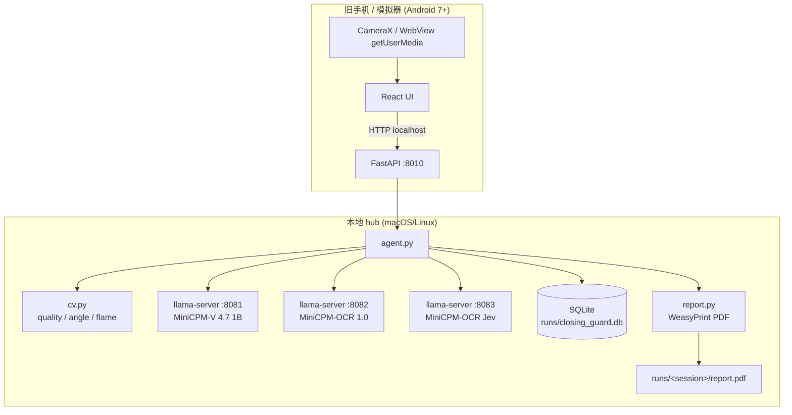

# Architecture

## Goal

Turn a closing checklist into a **task the agent can conduct**, not a form the
operator can fake. The unit of work is a *closing session*: a store, a checklist,
a sequence of evidence items, a human sign-off, and a hash-chained ledger.

## Runtime topology



- **No cloud calls.** The only network access is the local HTTP between the
  phone UI and the hub, and `scripts/download_models.sh` at setup time.
- The Android app is a thin WebView shell. It supplies camera, screen, speaker,
  and touch. This is deliberate: old phones do not need to compile llama.cpp,
  and the same UI works in the emulator/browser.
- `adb reverse tcp:8000 tcp:8010` maps the device's `localhost:8000` to the
  hub's `:8010`. `localhost` is a secure context, so `getUserMedia` works.

## Request flow

1. `POST /api/sessions` creates a session from a checklist YAML.
2. `POST /api/sessions/{id}/capture` receives an image + checkpoint id.
3. `agent.process_capture`:
   - normalizes the image (RGB JPEG, max 1600px, strips EXIF);
   - SHA-256 hashes the prepared bytes;
   - runs the quality gate (Laplacian variance, brightness, contrast);
   - runs the checkpoint-specific verifier:
     - `angle_vlm`: CV angle/flame + MiniCPM-V 1B (with the reference image);
     - `vlm`: MiniCPM-V 1B;
     - `ocr`: MiniCPM-OCR 1.0 raw + structured extraction, then Jev consistency score;
   - fuses the signals into `pass | fail | unsure`;
   - extends the session-wide hash chain and writes the evidence row.
4. `POST /api/sessions/{id}/confirm` records a human action (`confirm`,
   `reject`, `resolved`) on the latest evidence for a checkpoint.
5. `POST /api/sessions/{id}/complete` refuses to close while a critical item is
   fail/unsure without a human action, or a critical pass without a human
   confirmation. On success it renders the PDF and stores the final chain hash.
6. `GET /api/verify/{id}` recomputes the chain from evidence rows.

## State machine

```text
pending -> capture -> pass | fail | unsure
fail/unsure -> capture again (re-check) or human action (confirm/reject/resolved)
critical pass -> human confirmation required
all critical items resolved -> completed
```

The UI never lets a single model output close a critical item. The report says
"AI 建议 + 人工确认", not "AI 保证".

## Verdict fusion

| Signal | Role | Can it force FAIL? |
|---|---|---|
| Quality gate | reject unusable images before inference | no (→ unsure) |
| Flame colour check | catch a burner flame the 1B may miss | **yes** |
| CV angle delta | geometry cross-check against the reference | yes, only if CV confidence ≥ 0.35 |
| MiniCPM-V 1B | semantic state (valve / lock / panel) | yes (model fail) |
| MiniCPM-OCR 1.0 | meter/label reading | no (reading is informational; low confidence → unsure) |
| MiniCPM-OCR Jev | candidate-vs-image consistency | no (low score → unsure; never auto-fails the meter) |
| Human action | final authority for critical items | yes (reject) |

The CV confidence gate is intentional: a camera framing change can move the
dominant line by 80° even when the valve is fine (observed in the desktop fake
camera test). When CV confidence is low, it is a hint, not a veto.

## Hash chain

For each evidence item:

```text
payload = {id, session_id, checkpoint_id, image_sha256, captured_at,
           source, verdict, confidence, reason}
record_hash = sha256(canonical_json(payload))
chain_hash  = sha256(previous_chain_hash + record_hash)
```

The first item uses `sha256(session_id)` as the previous hash. The chain is
session-wide (not per checkpoint). `complete` stores the final chain hash;
`verify` recomputes from the DB and compares. The PDF embeds the final hash and
a QR code pointing to `/verify/{session_id}`.

This detects casual tampering (edited reason, swapped verdict, replaced image).
It is **not** a trusted timestamp or a hardware root of trust; see `SECURITY.md`.

## Data model

- `sessions`: id, store, checklist, operator, status, timestamps, chain hash,
  report path.
- `evidence`: one row per capture; image path, SHA-256, quality/CV/VLM/OCR JSON,
  verdict, confidence, reason, human action, chain hashes.
- `events`: append-only audit events (session created, capture, confirm,
  completed).

Images are stored under `runs/<session_id>/`; the DB under `runs/`.

## Model serving

`scripts/run_models.sh` starts two `llama-server` processes:

| Service | Model | Quant | Port |
|---|---|---|---|
| VLM | `MiniCPM-V-4_7-1B-Q4_K_M.gguf` + `mmproj-v47-f16.gguf` | Q4_K_M | 8081 |
| OCR | `MiniCPM-OCR-1_0-Q8_0.gguf` + `mmproj-ocr-4x.gguf` | Q8_0 | 8082 |
| Jev | `MiniCPM-OCR-Jev-Q4_K_M.gguf` + `mmproj-jev-f16.gguf` | Q4_K_M | 8083 |

The VLM request uses a GBNF grammar to force a JSON verdict
(`pass|fail|unsure`, confidence 0..1, Chinese reason). The OCR request uses the
official `Text Recognition:` / structured-extraction prompts. The Jev request
posts the region crop, a rendered image of the OCR candidate, and the candidate
text to `/v1/systemone`; `prob_1` is the consistency score. High scores
auto-accept, low scores route to a human. Jev never forces a safety FAIL — it
only makes the reading `unsure`.

## Deployment options

- **Laptop demo**: Mac + emulator/phone; `adb reverse`.
- **Shop edge box**: Mac mini / small x86 box on the store LAN; phones connect
  over the LAN. For a LAN (non-localhost) deployment, serve the UI over HTTPS
  so `getUserMedia` works; use a self-signed cert or a private CA.
- **Multi-store**: one hub per store, or a private server with per-store DBs.
  Evidence must not leave the store unless the operator opts in.

## Failure modes and design responses

| Failure | Response |
|---|---|
| Blurry/dark image | quality gate → unsure, ask for re-shoot |
| Valve handle obscured | CV low confidence + VLM unsure → re-shoot |
| Burner flame present | flame colour check forces fail |
| Breaker handles misread by 1B | critical item requires human confirmation; roadmap: CV handle detector |
| Meter last digit rolling | OCR returns unsure; human confirms |
| Device offline | UI queues nothing by default; the hub is required. Roadmap: on-phone fallback. |
| Model server down | API health shows offline; capture returns a clear error, not a silent pass |
